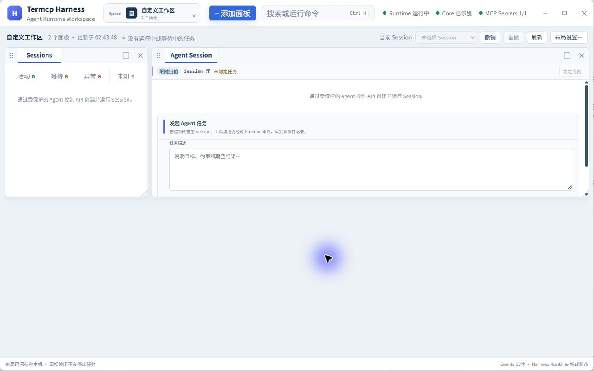
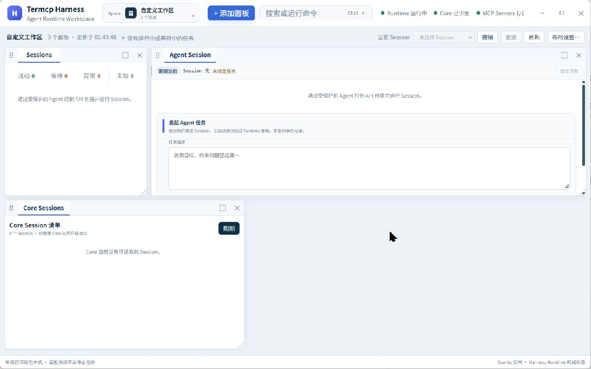

# Termcp Harness

Termcp Harness 是 **MCP 原生的 Agent Runtime 与人机共享终端工作台**。它把 Agent、MCP 工具、审批、终端输出和恢复操作放在同一个可观察的执行现场中，同时保持 Termcp Core 的独立执行权威。

当前 `dev` 快照：`v0.1.10`。版本记录见 [CHANGELOG.md](CHANGELOG.md)。

## 目录

- [界面预览](#界面预览)
- [当前能力](#当前能力)
- [Core 运行模式](#core-运行模式)
- [架构边界](#架构边界)
- [开发环境](#开发环境)
- [仓库结构](#仓库结构)
- [文档入口](#文档入口)

## 界面预览

| Agent Runtime 工作区 | Core Sessions 只读观察 |
| --- | --- |
|  |  |

界面把本地事件顺序、MCP 来源、Core 身份、Session、审批和 Terminal 放在同一个 Workspace 中，并可通过公开只读接口观察 Core 中已有的 Session。断线时保留最后快照，但明确标记为状态未知，不把旧数据冒充当前事实。

## 当前能力

- Go Headless Runtime、回环控制 API、健康检查和优雅关闭。
- 多来源 MCP Host：Streamable HTTP、SSE、stdio、健康检查、退避重连和能力刷新。
- 精确工具 allowlist、参数/结果上限、审批暂停、取消、失败和结果未知。
- Agent Session、确定性步骤、模型 Loop、停止/接管、transcript 和人工安全检查点恢复。
- 有界 Event Journal、SSE、Desktop cursor 重连和可选本地持久化。
- Core 身份与所有权：`external`、`managed`、`unverified`。
- 持久本地 Core profile、迟附着、Core Session 发现和真实 Terminal。
- Wails Desktop、多 Workspace、布局导入导出、审批时间线和 MCP 管理面板。
- Windows 安装器、完整便携 ZIP 和 Core overlay 补丁。

Harness 不 import Core 内部包，不复制 SSH/PTY 执行引擎，也不提供任意命令、文件或 URL 的通用桥接。

## Core 运行模式

### Managed Core

Desktop 启动自己的 Harness Runtime 和 Core 子进程；Harness 退出时停止 Core。

适合只在 Harness 内使用 Termcp、不需要后台 Core 的场景。

### Persistent Core

Core 通过公开 daemon 命令独立运行，Harness 以 `external` 身份连接，退出时不会停止 Core。

适合：

- 外部 Agent 或 Termcp 客户端需要在 Harness 未启动时直接使用 Core。
- 外部 Agent 先创建 Session，之后 Harness 需要重新连接并查看。
- Desktop/Runtime 重启期间需要保留 Core Session、Shell 和输出历史。

安装器提供“启用持久 Core”选项。安装包中的 [README.md](desktop/installer/README.md) 详细说明适用场景、启停、升级和卸载行为。

```powershell
.\termcp-harness.exe core service install
.\termcp-harness.exe core service start
.\termcp-harness.exe core service status
```

## 架构边界

```text
Agent / External Client
        |
        v
Harness Runtime ---- MCP Host ---- External MCP Servers
        |                  |
        | public HTTP/MCP  |
        v                  v
Termcp Core <--------------+
        |
        v
SSH / PTY / Remote Systems

Desktop Terminal Workspace
        |
        +-- fixed Go bridges --> Harness Runtime / Core
```

- **Termcp Core**：SSH、PTY、Session、Shell、文件、端口转发、审批和真实执行。
- **Harness Runtime**：Agent Loop、MCP Host、工具策略、审批协调、事件、Session 和恢复。
- **Terminal Workspace**：展示、审批、人工接管和恢复入口。

Runtime 内核、MCP 连接器、模型、工具、UI、存储和桌面扩展使用不同生命周期。发现、登记、连接、能力读取、启用和运行状态必须分别建模。

## 开发环境

- Go 1.27
- Wails v2.15.0
- Node.js 24
- React/TypeScript/Vite
- `@xterm/xterm` 5.5.0
- `@xterm/addon-fit` 0.10.0
- `github.com/mark3labs/mcp-go v0.50.0`

基础检查：

```powershell
go test -race ./...
go vet ./...
go build ./...
go mod tidy -diff
```

Desktop：

```powershell
Set-Location .\desktop\frontend
npm ci
npm run check
npm test
npm run build
Set-Location ..
wails build -m -nosyncgomod -clean -s
```

完整开发命令、集成测试环境变量和发布步骤见 [AGENTS.md](AGENTS.md)。

## 仓库结构

```text
cmd/termcp-harness/   Headless Runtime 与 CLI
internal/             Runtime、Core、MCP、工具、审批、事件和恢复
desktop/              Wails Desktop、固定桥、前端和安装/发布脚本
desktop/installer/    安装包 README 与 NSIS 模板
docs/                 产品、架构、ADR 和公开契约
examples/             只读工具策略与 Agent 步骤示例
```

## 文档入口

- [docs/README.md](docs/README.md)：完整文档索引与阅读顺序。
- [docs/product/VISION_v0.9.md](docs/product/VISION_v0.9.md)：产品定位与路线图。
- [docs/architecture/DESIGN_v0.4.md](docs/architecture/DESIGN_v0.4.md)：系统设计与安全边界。
- [docs/contracts/README.md](docs/contracts/README.md)：公开契约追踪规则。
- [docs/contracts/harness/v0.1/control-api.md](docs/contracts/harness/v0.1/control-api.md)：本地控制 API。
- [docs/contracts/harness/v0.1/core-instance.md](docs/contracts/harness/v0.1/core-instance.md)：Core 身份、所有权和持久 profile。
- [docs/contracts/harness/v0.1/agent-session.md](docs/contracts/harness/v0.1/agent-session.md)：Agent Session 与模型 Loop。
- [docs/contracts/harness/v0.1/terminal-bridge.md](docs/contracts/harness/v0.1/terminal-bridge.md)：Terminal 游标、重连和缺口语义。
- [docs/adr/ADR-023-persistent-core-late-attach.md](docs/adr/ADR-023-persistent-core-late-attach.md)：持久 Core、迟附着和安装升级策略。
- [AGENTS.md](AGENTS.md)：AI 编码 Agent 的工作规则。
